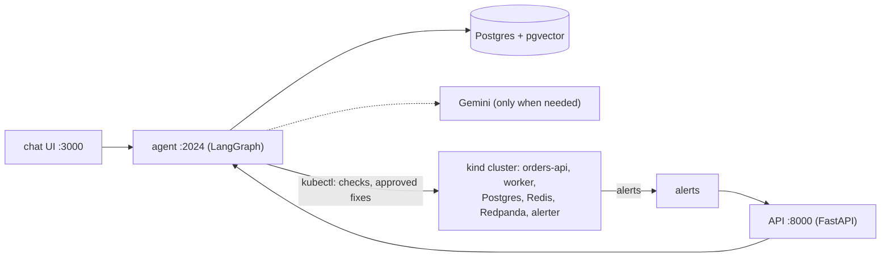
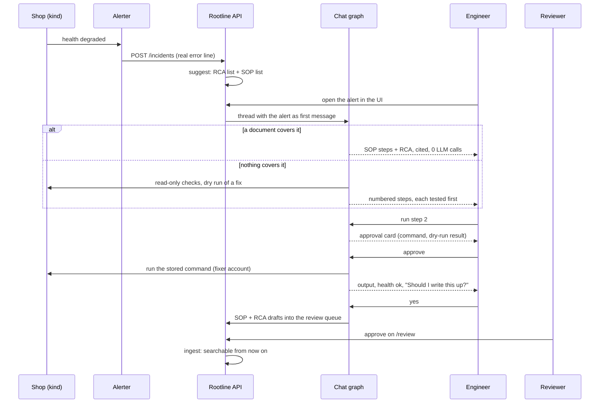
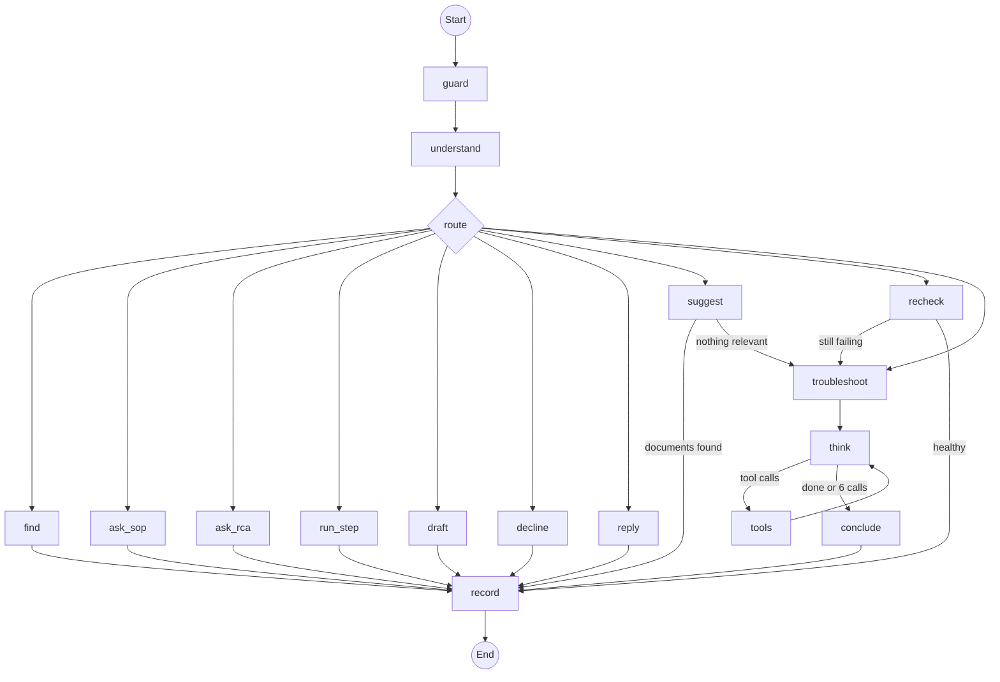

# Rootline

## The story

It's 2 a.m. and orders-api starts returning 503s. An alert fires. The on-call engineer now has to
find the right document among thousands: clean templated RCAs and SOPs, plus years of wiki pages,
email threads and Slack exports. Some of those are copies, some are out of date, and some mix an
incident report with a runbook. Opening the wrong one, or following a step out of order, makes the
outage worse.

Rootline sits between the alert and those documents:

- It reads the alert, matches the real error against the library, and returns the past incident
  (RCA) and the procedure (SOP) with its exact steps. That takes about a second and no LLM call.
- If nothing in the library covers the problem, it says so. An agent then checks the live system
  read-only, dry-runs each possible fix, and gives numbered steps.
- Nothing changes unless the engineer types `run step N` and approves it.
- Once health is back, it offers to write the fix up as a new SOP and RCA. A reviewer approves
  them, and the next engineer who hits the same alert gets them straight away.

To try it, the repo includes a small online shop that runs on a local Kubernetes cluster (kind):
orders-api, a worker, Postgres, Redis and Redpanda. You break it on purpose with `kubectl` and
watch Rootline handle it.



**Small Walkthrough:** one incident, from the alert to the fix. (just to help how to use)

<a href="https://youtu.be/f3ac9dkjslA"></a>


## Quick start

You need:
- Docker Desktop, running, with about 6 GB of memory
- [kind](https://kind.sigs.k8s.io/), `kubectl` and `make`
- ports 3000, 2024, 8000, 5432, 16443 and 30080 free

```bash
git clone https://github.com/iprajwaal/Rootline.git && cd Rootline
cp .env.example .env
# Optional for tests 1 and 2, needed for test 3:
#   GOOGLE_API_KEY=<key>   (for a Vertex AI key, also set LLM_VERTEXAI=true)

make cluster                    # 1. the shop on Kubernetes (~5 min)
docker compose up -d --build    # 2. Rootline (5 to 10 min the first time; builds the chat UI)
```

`make cluster` runs these steps:
```bash
kind create cluster --config cluster/kind.yaml              # API on :16443, orders-api on :30080
docker build -t shop-orders:dev cluster/orders              # one image for api, worker, traffic, alerter
kind load docker-image shop-orders:dev --name shop
kubectl --context kind-shop apply -f cluster/manifests      # namespace, Postgres, Redis, Redpanda, apps, RBAC
./cluster/kubeconfig.sh                                     # kubeconfig for Rootline: a read-only and a fixer account
```

Files: [`cluster/kind.yaml`](cluster/kind.yaml), [`cluster/orders/`](cluster/orders) (the shop's code),
[`cluster/manifests/`](cluster/manifests), [`cluster/kubeconfig.sh`](cluster/kubeconfig.sh).

Check it's ready:

```bash
kubectl config use-context kind-shop
kubectl -n shop get pods                  # all Running
curl -s localhost:30080/health | jq       # the shop: every component "ok"
docker compose ps -a                      # seed: Exited (0); postgres, api, agent, ui: Up
curl -s localhost:8000/healthz            # Rootline: {"status":"ok"}
```

| | |
|---|---|
| Chat | http://localhost:3000 |
| Review queue | http://localhost:8000/review |
| Ops (requests, latency, cost) | http://localhost:8000/ops |
| Shop health | http://localhost:30080/health |

Stop with `docker compose down` (add `-v` to wipe Rootline's database) and
`kind delete cluster --name shop`.

Without a key, Rootline uses the LLM answers and embeddings committed in [`cache/`](cache). Anything not
in the cache falls back to keyword search and rules, and the reply says so.

## Try it

Three things to try. Each one gives you only the starting point.

### 1. Break the system

```bash
kubectl -n shop set env deploy/orders-api DB_POOL_MAX=4
kubectl -n shop scale deploy/reports --replicas=6
curl -s localhost:30080/health | jq
```

Then watch the **Alerts** button in the chat (it can take up to a minute). More ways to break it
are in [`cluster/chaos.sh`](cluster/chaos.sh).

### 2. Ask about it in a new chat

Open a new chat and describe the problem the way you would to a teammate. Paste an error from
the shop's logs, ask how to fix it, or ask why it happened last time. If it gives you steps, you
can ask it to run one (`run step <n>`).

```bash
kubectl -n shop logs deploy/orders-api --since=2m | grep ERROR
```

### 3. A problem nobody has documented

```bash
make reset-k8s
kubectl -n shop exec statefulset/orders-db -- psql -U shop -d orders \
  -c "alter system set default_transaction_read_only = on" -c "select pg_reload_conf()"
```

There's no SOP or RCA for this one. Open the alert and work through it with Rootline until the
shop is healthy again. Then look at http://localhost:8000/review, and break it a second time.
This one needs an LLM key.

## How it works



Each chat turn goes through this graph:



What each node does:
- `guard` redacts secrets before anything else sees the message.
- `understand` uses rules, and asks the LLM only when they're unsure.
- `find`, `suggest` and `ask_sop` make no LLM calls.
- The agent (`troubleshoot` → `think` ⇄ `tools`) runs only when nothing in the library covers the
  issue.

What search returns (real output, warm):

```text
SOP-DB-001                                                         id · 10 ms
  [SOP] SOP-DB-001     Recover orders-api from database connection pool exhaustion
                       exact ID, 4 near-copies merged into this one

redis connection refused                                        hybrid · 39 ms
  [RCA] RCA-2025-031   Slow checkout while the cache was down
  [SOP] SOP-CACHE-001  Recover orders-api when the cache is down
                       matched: redis, connection, refused · service: cache

kafka lag                                                               hybrid
  [RCA] 3 similar incidents, marked ambiguous, none picked
  [SOP] SOP-QUEUE-002, then SOP-QUEUE-001 (superseded)

2026-10-20T03:14:07Z ERROR [orders-worker-7d9f8b6c5-x2klm] container killed: OOMKilled (exit code 137)
  [RCA] RCA-B-8BF782   Past incident with the same error OOMKilled and service orders-worker.
  [SOP] SOP-B-CBA1A4   Procedure with the same error OOMKilled and service orders-worker.
                       (both halves of one mixed legacy file)

psycopg.errors.ReadOnlySqlTransaction: cannot execute INSERT in a read-only transaction   19 ms
  No past incident matches this issue. No procedure covers this issue.
  -> handed to the agent
```

## Why a real Kubernetes shop

Rootline's checks and fixes are real commands (`kubectl`, `psql`, `redis-cli`), so it needs a real
system to run them against. A local kind cluster lets us break it the way production breaks:
- shrink the connection pool;
- move Redis off its port;
- ship a deploy with a missing setting;
- flood the queue;
- leave the database read-only.

Each fault is one `kubectl` command. Alerts fire from real health checks with the real error
line, and a reset takes seconds.

We considered Cloud Run. There, scaling replicas up and down, rolling back a revision or running a
command inside the database are not one-command operations, and every reviewer would need a GCP
project. kind runs on any laptop with Docker.

[`sandbox/shoplite`](sandbox/shoplite) is a simulated copy of the same shop. The automated tests and the scenario
runner use it; you don't need it to try Rootline.

## Key design decisions

- **Exact first, LLM last.** IDs, titles, stored steps, and alerts or errors shared with a doc
  decide most requests. Rules handle intent and doc type when they're sure. The LLM is used for
  the rest, and its output is checked by rules before anyone sees it.
- **RCAs and SOPs never mix.** They live in separate partitions and come back in separate lists.
  SOP steps are shown word for word. Every sentence of an RCA answer must cite a passage.
- **Doubt goes to a person.** Unsure types, unverified extractions, redacted secrets and possible
  duplicates become review items instead of guesses.
- **Advise, then act only on approval.** A fix runs only on `run step N`, after a dry run, and as a
  separate account.
- **One Postgres** for docs, vectors, full-text search, chat memory and cost. Each document is
  written in one transaction, so there are no duplicates.

The reasoning and the evidence behind each are in [DESIGN.md](DESIGN.md).

## Known limitations

- Eval numbers are on our own corpus (56 docs, 84 dev queries). The held-out split hasn't been
  run yet.
- Test 3 needs an LLM key. Without one, you get read-only checks instead of tested steps.
- The first query after a long idle can take ~12 s while Vertex opens a connection.
- An RCA follow-up like "why did this happen last time?" right after SOP steps doesn't pick up the
  SOP's incident yet. Name the issue instead.
- No auth on `/review`, and no CI workflow yet.
- Tested on Docker Desktop for macOS. The cluster reaches Rootline through `host.docker.internal`,
  which Docker on Linux doesn't provide by default.

## More

**Tests and eval.** Needs [uv](https://docs.astral.sh/uv/).

```bash
uv sync
make check                # ruff, mypy, pytest (offline, uses the committed caches)
make eval SPLIT=dev       # writes eval/runs/<time>-dev/report.md
make experiments          # keyword vs vector vs hybrid, rules vs LLM, threshold sweep
SHOP_MODE=shoplite make demo && make scenarios   # end-to-end stories on the simulated shop
```

**Docs.** [docs/](docs/README.md) has a page for each part: ingestion, retrieval, chat and
agent, the learning loop, the shop and cluster, eval, and operations.
