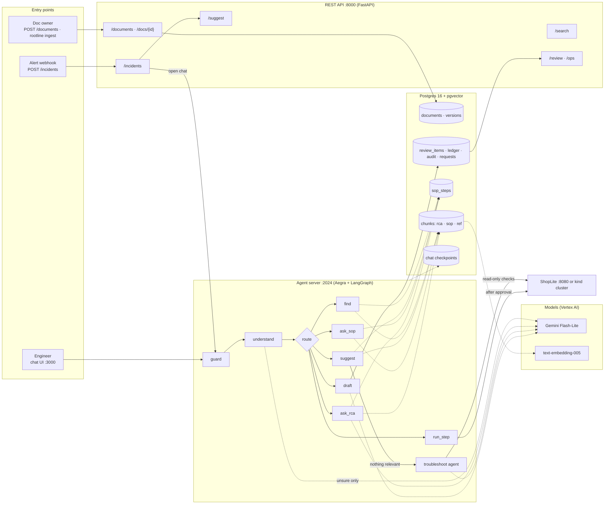
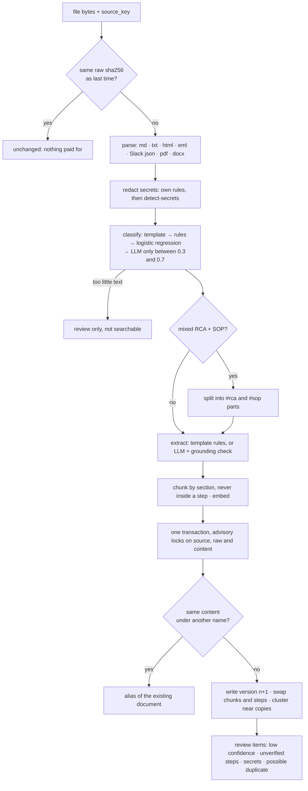
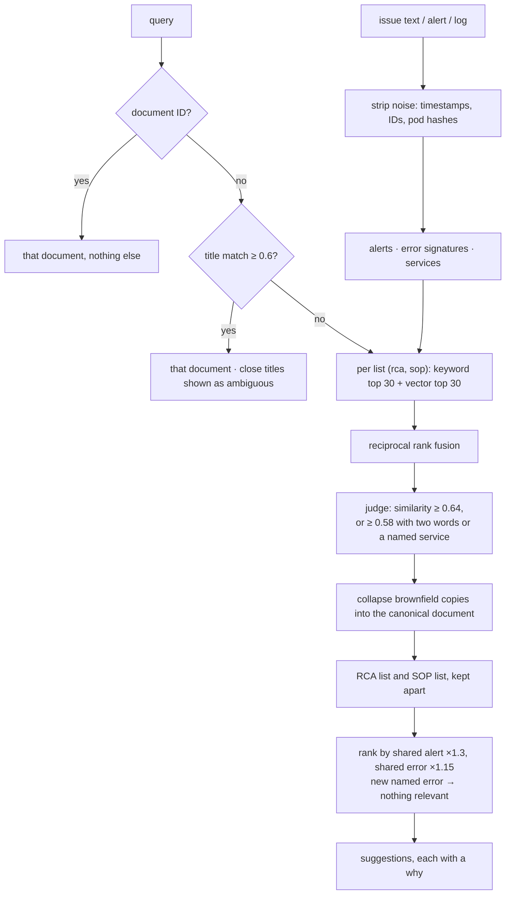
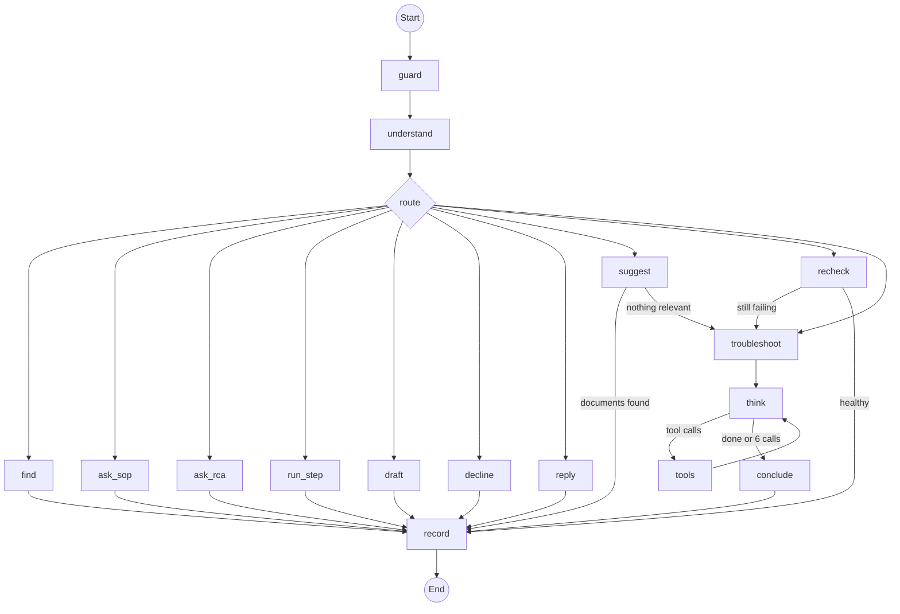
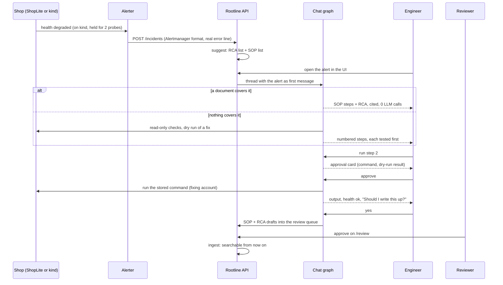

# 00: Flow

The whole system first, then one diagram per part. Each section links to the file that explains it
in detail.

---

## 1. End to end

Two doors lead to the same retrieval code: the REST API (fast, no agent, used by the eval) and the
chat graph (memory, citations, approvals). See [01-architecture.md](01-architecture.md).

---

## 2. Ingestion: one file, one transaction

Details and thresholds: [03-ingestion.md](03-ingestion.md).

---

## 3. Search and suggestions

Details: [04-retrieval.md](04-retrieval.md).

---

## 4. The chat graph

Every node writes a step to the trace, which the UI shows as the step log, and `record` writes one
row per turn to `requests`. Details: [05-chat-agent.md](05-chat-agent.md).

---

## 5. One incident, start to finish

The learning loop is in [06-learning-loop.md](06-learning-loop.md); the shop, faults and alerter in
[07-shop-and-cluster.md](07-shop-and-cluster.md).
